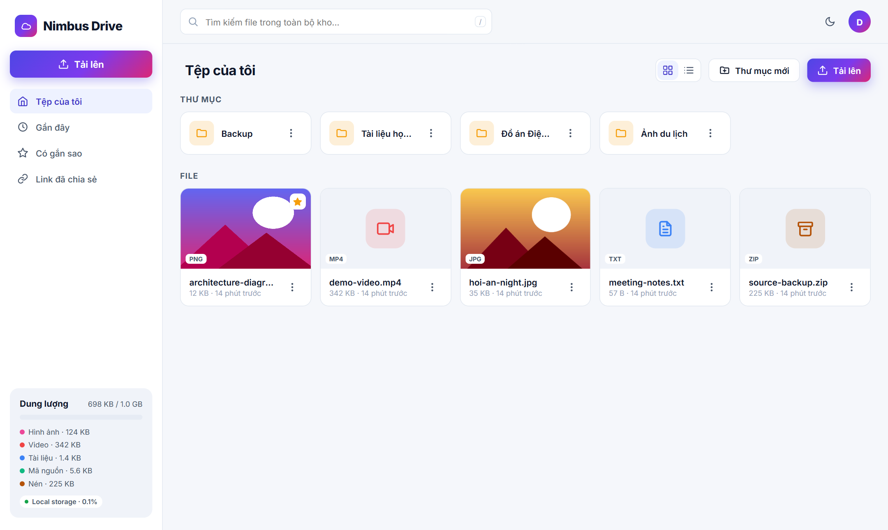

# ☁️ Nimbus Drive

**Design and Deployment of a Spring Boot Containerized Cloud File Storage Platform based on AWS S3-Compatible Architecture with an Automated CI/CD Pipeline**

Nimbus Drive là nền tảng lưu trữ file trên cloud (kiểu Google Drive thu nhỏ):
**Spring Boot 3 (Java 21)** + **PostgreSQL** (metadata) + **object storage chuẩn Amazon S3** (nội dung file),
đóng gói **Docker**, hạ tầng AWS mô tả bằng **Terraform**, build/test/scan/deploy tự động bằng **GitHub Actions**.



## Tính năng

| Nhóm | Chi tiết |
|---|---|
| Tài khoản | Đăng ký / đăng nhập JWT (HS256), mật khẩu BCrypt, khóa tạm 5 phút sau 5 lần sai |
| File | Upload kéo-thả nhiều file có thanh tiến độ, tải xuống, đổi tên, gắn sao, xóa, tìm kiếm |
| Thư mục | Thư mục lồng nhau, breadcrumb, kéo file thả vào thư mục, di chuyển, xóa đệ quy |
| Xem trước | Ảnh, PDF, video, audio, text/code ngay trên trình duyệt |
| Chia sẻ | Link công khai có thời hạn (1 giờ → không hết hạn), đếm lượt tải, thu hồi |
| S3 | Presigned URL tải trực tiếp từ S3 (15 phút), chạy được với AWS S3 / SeaweedFS / MinIO / Ceph |
| Quota | Mỗi user 1 GB (cấu hình được), thống kê dung lượng theo loại file |
| Vận hành | Health/liveness/readiness, Prometheus metrics, dashboard Grafana, Swagger UI, log xoay vòng |
| Bảo mật | CSP, chặn hiển thị inline HTML/SVG (chống XSS), kiểm tra quyền sở hữu → 404, IMDSv2, S3 mã hóa + chặn public |
| Giao diện | Responsive (mobile), sáng/tối, lưới/danh sách, phím tắt `/` tìm kiếm, `Esc` đóng |

## Kiến trúc

```
Trình duyệt ──HTTPS──> Caddy (TLS) ──> Spring Boot (container)
                                         ├── PostgreSQL 16 : users, folders, files, share_links  (Flyway migration)
                                         └── S3 API ──> SeaweedFS (local/self-host)  |  Amazon S3 (AWS)
Trình duyệt ──presigned URL──────────────────────────> S3 (tải trực tiếp, không qua app)
```

Mã nguồn chia lớp: `controller` (REST) → `service` (nghiệp vụ, quyền, quota) → `repository` (JPA) / `storage.ObjectStorage`
(port + adapter: `S3ObjectStorage`, `LocalObjectStorage`). Đổi nhà cung cấp storage chỉ là đổi biến môi trường.

> **Vì sao SeaweedFS thay vì MinIO?** Bản community của MinIO đã bị lưu trữ (archived) và ngừng phát hành binary
> (`dl.min.io` trả về `410 Gone`). SeaweedFS (Apache 2.0) vẫn được duy trì và nói chuẩn S3. Code không phụ thuộc
> vào nhà cung cấp — MinIO/Ceph/AWS S3 đều dùng được.

## Chạy nhanh

### Cách 1 — Docker (đầy đủ, giống production)
```bash
cp .env.example .env        # sửa mật khẩu/secret
docker compose up -d --build
```
- Web: http://localhost:8080 · Swagger: http://localhost:8080/swagger-ui.html
- S3 endpoint (SeaweedFS): http://localhost:8333
- Giám sát: `docker compose --profile monitoring up -d` → Grafana http://localhost:3000 (admin/admin), Prometheus :9090

### Cách 2 — Không cần Docker (dev)
H2 database + lưu file vào thư mục `./data`:
```bash
./mvnw spring-boot:run -Dspring-boot.run.profiles=dev      # Windows: mvnw.cmd ...
```

### Test
```bash
./mvnw verify
```
- 18 unit/API test (MockMvc + H2) chạy ở mọi máy, độ phủ dòng ~80% (báo cáo JaCoCo: `target/site/jacoco`).
- `*IT` dùng **Testcontainers** (PostgreSQL thật, SeaweedFS S3 thật) — tự bỏ qua nếu máy không có Docker, chạy trên CI.

## API chính

| Method | Endpoint | Mô tả |
|---|---|---|
| POST | `/api/auth/register`, `/api/auth/login` | Trả JWT |
| GET | `/api/me` | Hồ sơ, dung lượng đã dùng, thống kê theo loại |
| GET/POST | `/api/files` | Liệt kê (`folderId`, `q`, `view=recent\|starred\|all`) / upload multipart |
| GET | `/api/files/{id}/download?inline=` | Tải / xem trước |
| GET | `/api/files/{id}/presign` | Presigned URL S3 |
| PATCH · POST `/move` · PUT `/star` · DELETE | `/api/files/{id}` | Đổi tên, di chuyển, gắn sao, xóa |
| GET/POST/PATCH/DELETE | `/api/folders`, `/api/folders/{id}/path` | Thư mục |
| POST | `/api/files/{id}/shares` | Tạo link chia sẻ |
| GET/DELETE | `/api/shares` | Link của tôi / thu hồi |
| GET | `/api/public/shares/{token}[/download]` | Công khai, không cần đăng nhập |

Lỗi trả về chuẩn RFC 7807 (`application/problem+json`).

## CI/CD (`.github/workflows/ci-cd.yml`)

1. **Build & test** — mọi push/PR: `mvn verify` (unit + integration Testcontainers), lưu báo cáo test + coverage.
2. **Docker image** — build multi-stage (layered jar, user không phải root, healthcheck); push GHCR với tag `latest` + `sha-<commit>`; quét lỗ hổng **Trivy**.
3. **Deploy** — (khi `DEPLOY_ENABLED=true`) SCP compose lên server, `docker compose pull && up -d` với image theo commit, **smoke test** `/actuator/health`, tự in log nếu lỗi.

Cấu hình: repo variable `DEPLOY_ENABLED=true`, `APP_URL`; secrets `DEPLOY_HOST`, `DEPLOY_USER`, `DEPLOY_SSH_KEY`.
Nếu package GHCR để private, server phải `docker login ghcr.io` một lần bằng PAT có quyền `read:packages`.

## Triển khai lên AWS (Terraform)

```bash
cd deploy/terraform
cp terraform.tfvars.example terraform.tfvars   # key_name, app_image, domain
terraform init && terraform apply
```
Tạo: S3 bucket (SSE-AES256, versioning, chặn public, lifecycle, CORS) · IAM role quyền tối thiểu (chỉ Get/Put/Delete trên bucket) ·
EC2 Ubuntu 24.04 (IMDSv2, ổ mã hóa) cài sẵn Docker · Security Group 80/443/22 · Elastic IP.
Trên EC2 app dùng `docker-compose.aws.yml` → Amazon S3 thật, credential lấy từ **IAM instance profile** (không lưu access key).
Sau đó đặt `DEPLOY_HOST` = output `public_ip` và push lên `main`.

> Terraform đã được viết và kiểm tra cú pháp thủ công nhưng chưa `apply` trên tài khoản AWS thật trong quá trình phát triển.

## Cấu trúc thư mục

```
src/main/java/com/cloudfs/
  config/      StorageConfig (S3Client, S3Presigner, chọn backend), OpenApiConfig
  controller/  Auth, Me, File, Folder, Share
  service/     FileService, FolderService, ShareService, LoginAttemptService, FileCategory
  storage/     ObjectStorage (port), S3ObjectStorage, LocalObjectStorage
  security/    JWT filter/service, SecurityConfig (CSP, stateless)
  web/         ApiExceptionHandler (RFC 7807)
src/main/resources/
  db/migration/V1__init.sql    static/ (index, app, share .html + css + js)
deploy/  seaweedfs/ caddy/ monitoring/ terraform/
docs/    screenshots/, report/ (báo cáo Word + slide)
```

## Hướng phát triển

Thùng rác + khôi phục · multipart upload trực tiếp lên S3 bằng presigned PUT (file > 5 GB) · phiên bản file (S3 versioning) ·
chia sẻ cho user khác với phân quyền · Redis cho rate-limit khi chạy nhiều instance · RDS + ECS Fargate/EKS + CloudFront ·
quét virus (ClamAV) khi upload · refresh token / OAuth2 (Google) · mã hóa phía client.
